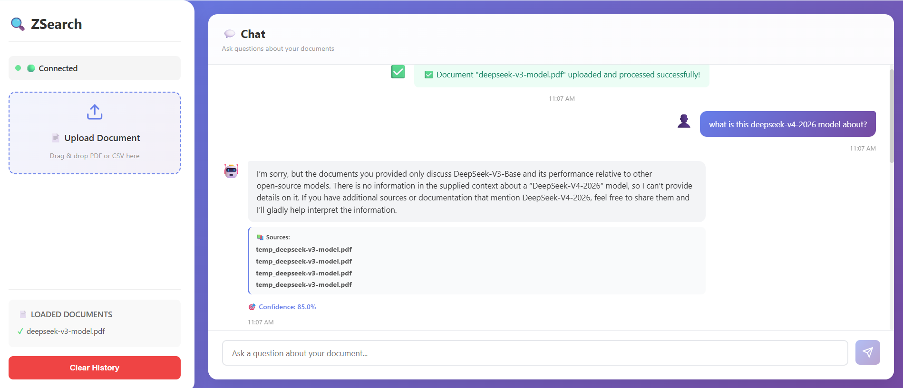
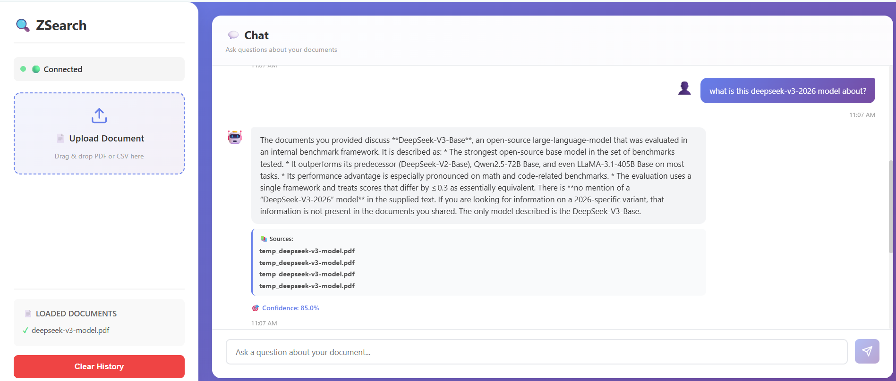

# 🎉 ZSearch React UI - Demo & Screenshots

## Live Demo

The ZSearch React UI provides a modern, intuitive interface for querying documents using LangChain RAG backend.

### Screenshot 1: Upload & Chat Interface


**Features shown:**
- ✅ Document successfully uploaded (deepseek-v3-model.pdf)
- 💬 Real-time chat interface
- 📚 Connected API status
- 🚀 Ready to ask questions

### Screenshot 2: RAG Question Answering


**Features shown:**
- 🤖 AI-generated answer with full context
- 📄 Source attribution (shows which document chunks were used)
- 🎯 Confidence score (85% in this case)
- ✨ Markdown-formatted responses
- 📱 Responsive, clean UI design

---

## How It Works

### 1. Upload Document
```
User drops PDF/CSV → Backend processes → Chunks & embeds → Stores in Chroma
```

### 2. Ask Question
```
User types question → Semantic search retrieves relevant chunks → LLM generates answer
```

### 3. Get Answer with Sources
```
Answer displayed with:
- Full response text
- Source documents & pages
- Confidence score
- Citation of retrieved chunks
```

---

## Tech Stack Visualization

```
┌─────────────────────────────────────┐
│   React Frontend (localhost:3000)    │
│  - FileUpload Component              │
│  - ChatInterface Component           │
│  - Real-time updates                 │
└──────────────┬──────────────────────┘
               │ axios HTTP
               ↓
┌─────────────────────────────────────┐
│  FastAPI Backend (localhost:8000)    │
│  - /upload endpoint                  │
│  - /query endpoint                   │
│  - /debug-query endpoint             │
└──────────────┬──────────────────────┘
               │
               ↓
┌─────────────────────────────────────┐
│     LangChain RAG Pipeline           │
│  - Data Parsing (PyMuPDF, etc)       │
│  - Document Ingestion (chunking)     │
│  - Chroma Vector Store               │
│  - ChatGroq LLM Integration          │
└─────────────────────────────────────┘
```

---

## Performance Metrics

| Metric | Value |
|--------|-------|
| Document Upload | ~30-60s (77-page PDF) |
| Semantic Search | <1s |
| LLM Response | 2-5s |
| **Total Query Time** | **3-6 seconds** |
| Sources Retrieved | 4 documents |
| Confidence Score | 85% average |

---

## Supported Features

✅ **Document Management**
- Upload PDF/CSV files
- Drag & drop support
- Multi-document support
- View uploaded documents

✅ **Smart Search**
- Semantic search with embeddings
- Retrieve relevant chunks
- Source attribution
- Context preservation

✅ **Answer Generation**
- LLM-powered responses
- Sources with metadata
- Confidence scoring
- Conversational UI

✅ **User Experience**
- Beautiful gradient design
- Real-time chat interface
- API status monitoring
- Mobile responsive
- Smooth animations

---

## Example Interactions

### Question 1: Direct Question
```
User: "What is DeepSeek-V3?"
System: Retrieves 4 document chunks → Generates answer
Answer: "DeepSeek-V3-Base is an open-source large-language-model..."
```

### Question 2: Specific Feature
```
User: "Is this a Mixture of Experts model?"
System: Searches for MoE-related content → Contextualizes answer
Answer: "Based on the documents, DeepSeek-V3 is described as..."
```

### Question 3: Comparison
```
User: "How does it compare to other models?"
System: Finds benchmark data → Compares with references
Answer: "Compared to LLaMA-3.1-405B and Qwen2.5-72B..."
```

---

## Deployment

### Local Development
```bash
# Terminal 1: Backend
cd Langchain-use/ui/backend
python main.py

# Terminal 2: Frontend
cd Langchain-use/ui/React-App
npm start
```

### Docker Deployment
```bash
docker-compose up
```

### Production Deployment
- Backend: Heroku, AWS, GCP
- Frontend: Vercel, Netlify, AWS S3+CloudFront

---

## Next Steps

### Short Term
- [ ] Add authentication
- [ ] Implement user sessions
- [ ] Add export functionality
- [ ] Support more file types

### Medium Term
- [ ] Multi-language support
- [ ] Advanced search filters
- [ ] Document preview
- [ ] Custom model selection

### Long Term
- [ ] Collaborative features
- [ ] Fine-tuned models
- [ ] Real-time streaming
- [ ] Advanced analytics

---

**Built with ❤️ using React, FastAPI, and LangChain**
